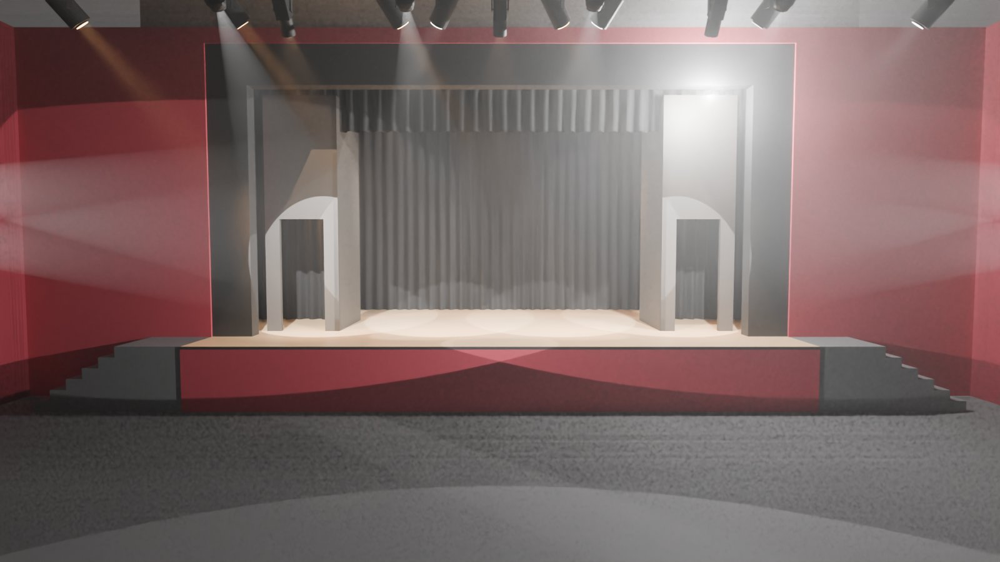
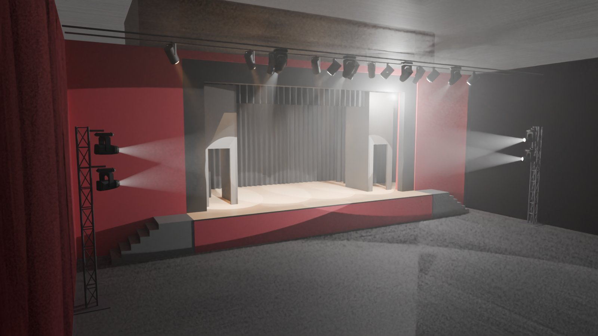
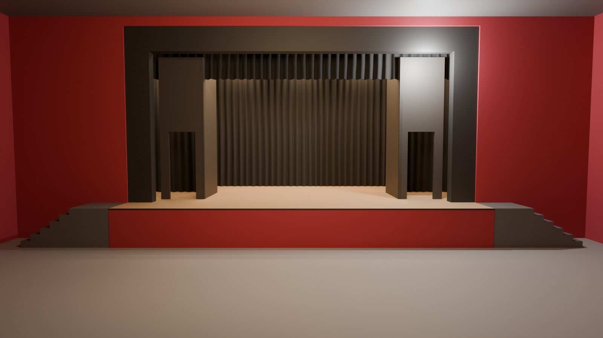

# 3d-theatre

Parametric theatre stage for Blender 5.3. One set of parameters generates a
1:1 scale mock-up of a theatre: stage, house, proscenium, fly tower, grid,
stairs, side modules, masking, main curtain and work lights, plus an optional
lighting rig (fixtures from a GDTF-based library, driven live over DMX,
exportable to QLC+). Everything derives from one schema, is saved as YAML
presets, and rebuilds without losing your materials.



> **Branches.** `master` holds the stage generator. The lighting rig (fixture
> library, DMX, QLC+ export, `tools/gdtf_to_fiche.py`) lives on
> **`feat/lighting-rig`** until it is merged. The renders in this README were
> made with the rig branch.
>
> **Language.** The panel UI and `docs/spec.md` are in French. Code,
> identifiers and this README are in English; French stage terms are given in
> parentheses where useful.

## Features

### Stage and house architecture
- Stage deck, apron (avant-scène), proscenium frame (cadre de scène), fly
  tower (cage de scène), grid (gril) and battens (porteuses), all dimensioned
  from parameters. Derived dimensions are shown in the panel.
- House (salle) with floor, walls and optional ceiling; work lights on the grid
  and in front of house.
- Audience cameras (`Cam_Face`, `Cam_Jardin`, `Cam_Cour`) placed relative to the
  stage edge.

### Stairs and side modules
- Side stairs and optional central stairs, with riser/going rules and landings.
- Left and right modules (return walls) with optional door and window,
  symmetric or independent.

### Masking
- Legs and borders (pendrillons, frises) in the Italian (à l'italienne) or
  German (à l'allemande) layout, with a configurable number of wings (rues).
- Borders are fitted to the sightlines from the reference seat, so nothing
  backstage shows.

### Main curtain
- Draped main curtain (rideau à la grecque) whose opening is driven by a
  driver, so it animates on the timeline.

### Haze
- One homogeneous volume box covering house and stage, or a stage-only box
  fading towards the audience. Density is animatable; render settings are
  tuned for visible beams.

### Materials and presets
- Rebuild deletes only objects tagged `theatre_generated`. Materials are looked
  up by name and never overwritten, so shaders assigned on top (BlenderKit
  for instance) survive.
- Presets are YAML files, shipped (`open_space`, `reference_with_modules`) or
  user-saved. The panel, the property group and the presets all derive from one
  schema (`core/params.py`).

### Lighting rig (branch `feat/lighting-rig`)
- **Fixture library.** A fixture is a YAML fiche (`library/fixtures/<id>/`),
  never code, built from a GDTF file where one exists. Seven fiches ship:
  Martin MAC Aura, Robe Robin Esprite, ETC Source Four LED Series 3 (Lustr X8
  and Daylight HDR), a generic LED PC, a generic wide LED Fresnel and a
  generic hazer.
- **Layout.** McCandless crossed face lighting (45° site and azimuth, warm and
  cool sides), backlights on the upstage pipe, moving heads on a second front
  pipe and on side towers, and three profiles with auto-framed shutters.
- **Checks.** Collisions between fixture bodies, beams against masking and
  borders, loads per support, DMX patch overlaps.
- **Live DMX.** QLC+ sends sACN; DMX Visualizer writes scene props
  `dmx_<universe>_<channel>`; drivers move pan, tilt, shutters, colour, gobos,
  zoom and dimmer on the fixtures.
- **QLC+ export.** One channel table for Blender and the console: a `.qxw`
  workspace with fixtures, groups, rest scenes and position palettes, plus
  `.qxf` definitions where QLC+ has none.
- **Rest values and blackout.** "Plein feu de repos" writes every channel to
  its rest value; "Noir général" sets all of them to 0 so the console alone
  lights the stage.
- **Photometry.** Lumens to Blender power is calibrated against Cycles, from
  the IES profiles and lumen figures of the fiches.

| Three-quarter view from the house | Architecture, work lights only |
|---|---|
|  |  |

## Requirements

- Blender 5.3 on Windows x64 (the manifest ships a PyYAML wheel for CPython
  3.13).
- For the rig: [QLC+](https://qlcplus.org/) 4.14 and the DMX Visualizer add-on
  from [`JulienCr/blender-tools`](https://github.com/JulienCr/blender-tools).
- To run the tests: Python 3 with `pytest` and `PyYAML`.

## Installation

Clone the repository, then link the extension folder into Blender's user
repository, so that you edit sources in the clone and never in AppData
(PowerShell):

```powershell
New-Item -ItemType Junction `
  -Path "$env:APPDATA\Blender Foundation\Blender\5.3\extensions\user_default\theatre_stage" `
  -Target "<clone>\blender\theatre_stage"
```

Then in Blender, refresh the repositories and enable the extension, from
Preferences or from the Python console:

```python
import bpy
bpy.ops.extensions.repo_refresh_all()
bpy.ops.preferences.addon_enable(module="bl_ext.user_default.theatre_stage")
```

Enabling also installs the PyYAML wheel. A "Failed to remove _yaml...pyd"
message on disable is harmless.

## Usage

Open the 3D view sidebar (N) and select the **Théâtre** tab. Pick a preset
(`reference_with_modules` is a good start), press *Charger*, then change
parameters: the scene rebuilds as you edit. The panel groups parameters as in
`docs/spec.md` section 3 and shows computed dimensions and warnings, all in
French. *Enregistrer sous…* writes the current parameters as a user preset in
YAML.

`docs/spec.md` is the source of truth for every dimension rule, default value
and object name.

## DMX setup

1. In the panel, press *Exporter vers QLC+* and open the resulting `.qxw` in
   QLC+.
2. In QLC+ Inputs/Outputs, give each universe an **E1.31 output, unicast to
   127.0.0.1, multicast off**, one line per universe.
3. In Blender, enable DMX Visualizer and make it listen on the same universe
   range. It writes the `dmx_<universe>_<channel>` scene props and the fixtures
   follow through drivers.

Nothing is keyframed: Blender is only a visualiser. Use *Noir général* so only
the console drives the stage.

## Adding a fixture

```
python tools/gdtf_to_fiche.py <file.gdtf> --id <id> \
  --out blender/theatre_stage/library/fixtures/<id>/
```

The tool writes `fixture.yaml`, copies the GDTF, converts meshes and extracts
gobo images. Fill the remaining `null` fields (family, mounting, lens offset,
field angles, blade geometry), then press *Recharger la bibliothèque*: an
invalid fiche is skipped and its faulty keys are listed in the panel warnings.
See `blender/theatre_stage/library/fixtures/README.md` and spec section 12.

## Development

- `blender/theatre_stage/core/` is pure Python: no `bpy`, only relative
  imports. Every dimension rule lives there and is tested.
- Parameters are declared once in `core/params.py`; the property group, the
  panel and the presets derive from it.
- Tests: `python -m pytest` from the repo root.
- Types: `pyright blender/theatre_stage tools` (only the `bpy` imports are
  reported).
- A change is checked in a live Blender: rebuild, render from `Cam_Face`,
  compare with a reference view.
- `tools/publish_public.sh` publishes a filtered copy of the history (no
  manufacturer PDFs, no reference photos).

## Project docs

- [`docs/spec.md`](docs/spec.md) (French): parameters, geometry, masking,
  presets, fixture library, rig layout, DMX, QLC+ export.
- [`BACKLOG.md`](BACKLOG.md) (French): known gaps and ideas.

## License

GPL-3.0-or-later, see [`LICENSE`](LICENSE).

## Third-party data

The lighting-rig branch ships data that belongs to its manufacturers: GDTF
files, IES photometric profiles, fixture meshes and gobo images (Martin, Robe,
ETC, Chauvet and others). They are included for interoperability and are not
covered by the GPL. Each fiche cites its source URLs. Manufacturer datasheets
(PDF) and reference photos are not part of the public history. Product names
are trademarks of their owners.
